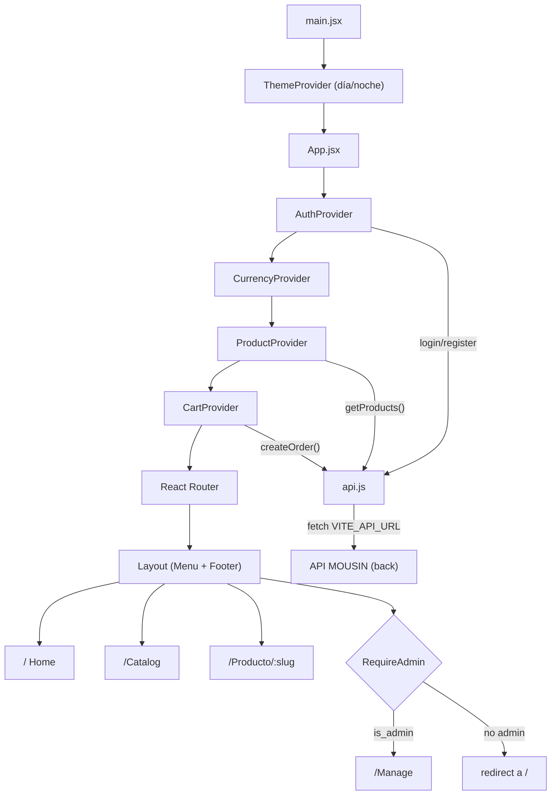
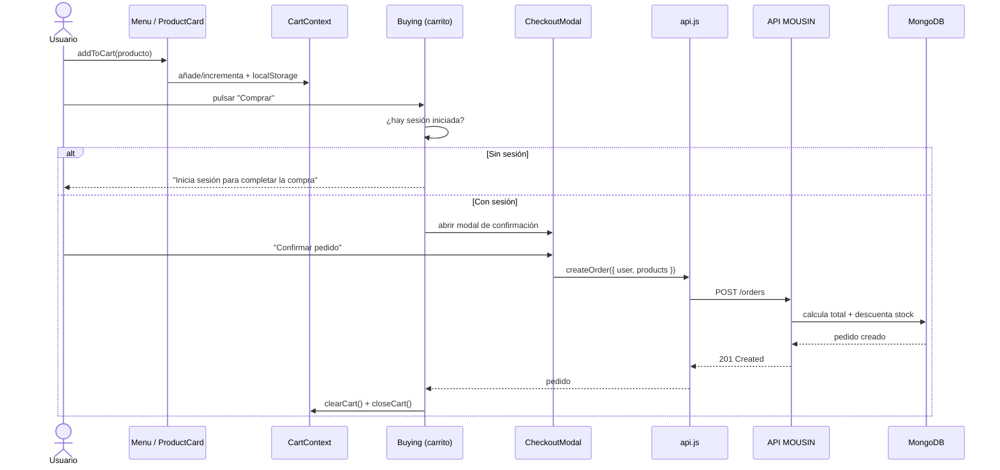

# MOUSIN — Frontend

Tienda de **periféricos de precisión** (teclados mecánicos, ratones, mandos,
audio y accesorios). SPA en React que consume la API REST de MOUSIN para el
catálogo, los usuarios y los pedidos.

El código de la aplicación vive en la carpeta [`front/`](./front).

## Tecnologías

| Categoría        | Tecnología                                        |
| ---------------- | ------------------------------------------------- |
| Librería UI      | React 19                                          |
| Build / Dev      | Vite 8 (`@vitejs/plugin-react`)                   |
| Rutas            | React Router 7 (`createBrowserRouter`)            |
| Estilos          | Tailwind CSS 4 (`@tailwindcss/vite` + config CDN) |
| Tipografía       | Nunito Sans (Google Fonts)                        |
| Iconos           | Material Symbols Outlined                         |
| Lint             | Oxlint                                            |
| Despliegue       | Vercel (SPA rewrite a `index.html`)               |

## Estructura del proyecto

```
front/
├── public/
├── src/
│   ├── api/
│   │   └── api.js               # Capa de acceso a la API del back
│   ├── components/
│   │   ├── AccountMenu/         # Desplegable de la cuenta + moneda
│   │   ├── Auth/                # Formularios de login y registro
│   │   ├── AuthModal/           # Modal de acceso
│   │   ├── Buying/              # Panel desplegable del carrito
│   │   ├── CartToast/           # Aviso "añadido al carrito"
│   │   ├── CheckoutModal/       # Confirmación de compra
│   │   ├── ConfirmModal/        # Confirmación genérica (borrados)
│   │   ├── Footer/
│   │   ├── Layout/              # Cabecera + contenido + pie
│   │   ├── Menu/                # Barra de navegación
│   │   ├── OrdersList/          # Pedidos (administración)
│   │   ├── ProductCard/         # Tarjeta de producto
│   │   ├── ProductDetail/       # Ficha de producto
│   │   ├── ProductEditModal/    # Alta/edición de producto
│   │   ├── ProductFilters/      # Búsqueda y filtro por categoría
│   │   ├── ProductManageList/   # Fila de producto (administración)
│   │   ├── RequireAdmin/        # Guarda de ruta solo para admin
│   │   └── UnderConstruction/
│   ├── context/
│   │   ├── AuthContext.jsx      # Sesión (login/registro/logout)
│   │   ├── CartContext.jsx      # Carrito persistido en localStorage
│   │   ├── CurrencyContext.jsx  # Divisa activa y formateo
│   │   └── ProductContext.jsx   # Catálogo y CRUD de productos
│   ├── hooks/
│   │   ├── usePageMeta.js       # Título/meta por página
│   │   └── useProductFilters.js # Búsqueda + categoría
│   ├── pages/
│   │   ├── Home.jsx
│   │   ├── Catalog.jsx
│   │   └── Manage.jsx
│   ├── theme/
│   │   └── palette.css          # Paleta de marca de MOUSIN
│   ├── ui-theme/                # Paquete día/noche (ver README propio)
│   ├── utils/
│   │   ├── currency.js          # Conversión y formato multi-divisa
│   │   └── slugify.js           # Slugs para URLs de producto
│   ├── App.jsx                  # Rutas + providers
│   ├── main.jsx                 # Punto de entrada
│   └── index.css
├── index.html
└── vite.config.js
```

## Arquitectura

`main.jsx` monta el `ThemeProvider` y `App.jsx` envuelve la app con los
providers de datos; el orden importa porque el carrito consume productos y moneda.



## Flujo de compra



## Rutas

Todas cuelgan del `Layout` común (cabecera + contenido + pie).

| Ruta             | Página          | Acceso                       |
| ---------------- | --------------- | ---------------------------- |
| `/`              | `Home`          | Público                      |
| `/Catalog`       | `Catalog`       | Público                      |
| `/Producto/:slug`| `ProductDetail` | Público                      |
| `/Manage`        | `Manage`        | Solo administradores         |

## Contextos

| Contexto          | Responsabilidad                                                  |
| ----------------- | ---------------------------------------------------------------- |
| `AuthContext`     | Sesión (`user`) con login/registro/logout, persistida en `localStorage`. |
| `ProductContext`  | Carga el catálogo y expone `createProduct`, `updateProduct`, `deleteProduct`. |
| `CartContext`     | Artículos del carrito, cantidades, total y persistencia.         |
| `CurrencyContext` | Divisa activa y helper `format()` para mostrar importes.         |

## Características destacadas

- **Tema día/noche** sin parpadeo al recargar, mediante el paquete
  [`src/ui-theme`](./front/src/ui-theme/README.md) (View Transitions + script
  anti-flash en `index.html`).
- **Multi-divisa**: EUR, USD, GBP, MXN, COP, CLP, ARS, BRL, JPY y CHF, con sus
  tipos de cambio y formatos locales (`src/utils/currency.js`).
- **Búsqueda y filtrado** por nombre (insensible a acentos) y categoría
  (`useProductFilters`).
- **Acceso de administración**: los enlaces y la ruta `/Manage` se protegen con
  `RequireAdmin` comprobando `user.is_admin`.
- **Fichas con slug**: la URL de cada producto usa `slugify`.

## Capa de API

`src/api/api.js` centraliza la URL base y las peticiones `fetch`, y convierte el
`_id` de MongoDB en `id` para el resto de la app.

```js
const API_URL = (import.meta.env.VITE_API_URL ?? "").replace(/\/+$/, "");
```

Funciones exportadas: `getProducts`, `createProduct`, `updateProduct`,
`deleteProduct`, `registerUser`, `loginUser`, `getOrders`, `createOrder`,
`deleteOrder`.

## Variables de entorno

Crea `front/.env.local` (en local) o defínela en Vercel:

```env
VITE_API_URL=http://localhost:3000
```

Si no se define, las peticiones se hacen contra el mismo origen (útil cuando el
front y el back comparten dominio).

## Puesta en marcha

```bash
# Dentro de front/
npm install
npm run dev       # servidor de desarrollo (Vite --host)
npm run build     # build de producción en dist/
npm run preview   # sirve el build
npm run lint      # Oxlint
```

## Despliegue

Incluye [`vercel.json`](./front/vercel.json) con un rewrite de todas las rutas a
`/index.html`, necesario para que el enrutado del lado del cliente funcione.
